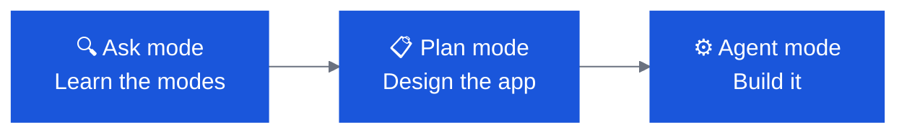

# OpenSlava — Beginner Track

Three labs · ~70 minutes total · No prior Bob experience needed

---

## Track Overview

| # | Lab | Time | Goal |
|---|---|---|---|
| B1 | **Explore Modes & Build the OpenSlava 2026 Welcome App** | 25 min | Learn the three Bob modes by building a confetti welcome page |
| B2 | **Connect & Expand Galaxium Travels: Flights with Layovers** | 25 min | Add a real feature to a full-stack app using Ask → Plan → Agent |
| B3 | **Date Picker, Price Ranker & Booking Agent** | 20 min | Three quick enhancements showing Bob handling UI, logic, and mock AI |

!!! tip "How to use this guide"
    Each lab builds on the previous one. Complete them in order. Every prompt block is copy-pasteable — click the copy icon on the top-right of any code block.

---

## Prerequisites

- [ ] **IBM Bob IDE** installed and signed in — download from [bob.ibm.com/download](https://bob.ibm.com/download) (standalone app, not a VS Code extension), or **Bob Shell** if you prefer a terminal (`curl -fsSL https://bob.ibm.com/download/bobshell.sh | bash`)
- [ ] Node.js 20 LTS installed
- [ ] Git installed
- [ ] Galaxium Travels repo available at `galaxium-travels/` (already included in the workshop repo — no separate clone needed)

---

## Lab B1 — Explore Modes & Build the OpenSlava 2026 Welcome App

**25 minutes** · No code experience needed

### What you will learn

The three Bob modes — **Ask**, **Plan**, and **Agent** — each have a distinct role. This lab makes the difference tangible by using all three to build a single small app.



### Why use three modes instead of just one?

Splitting work across modes is a **smart development pattern**, not just a Bob quirk. Each mode has different tool permissions by design:

- **Ask** can read files but cannot write or run commands — safe for exploration and Q&A
- **Plan** can read files and write documentation (e.g. `.md` plan files), but cannot run shell commands — ideal for design without side-effects
- **Agent** can read, write, and run commands — the full power of an autonomous coding agent

Using the right mode for each phase keeps Bob's actions **predictable, reviewable, and reversible**. When you prototype in Ask, nothing breaks. When you finalize in Agent, every action is intentional.

### Step 1 — Ask mode: understand the modes

1. Open **IBM Bob** on an **empty folder**
2. Select **Ask** mode
3. Send this prompt:

```
What are the three built-in Bob modes, what tools does each one permit,
and when should I use each?
```

**Observe:** Bob gives a clear answer but cannot create files or run commands.
Ask mode is read-only by design — perfect for questions and exploration.

!!! info "Ask mode = read-only"
    Ask mode has no `edit` or `command` tool groups. Bob can see your code but cannot touch it. This is the safest mode to use when you want answers without the risk of unintended changes.

### Step 2 — Plan mode: design the app

1. Switch to **Plan** mode in the sidebar
2. Send this prompt:

```
Plan a React + Vite app called "OpenSlava 2026 Welcome".
It should show a full-screen welcome page with:
- Background colour IBM Bob blue (#0f62fe)
- White text: "Welcome to OpenSlava 2026"
- Subtitle: "Powered by IBM Bob"
- A confetti burst when the page loads

The confetti must use only CSS keyframe animations and vanilla JS — no npm packages.
Produce a component list, the CSS animation approach, and a file layout.
```

**Observe:** Bob produces a detailed plan — component names, CSS strategy, file tree — but writes nothing to disk. Plan mode can design but not implement.

!!! info "Plan mode = design without side-effects"
    Plan mode can read files and write documentation (like plan notes or `.md` files), but cannot execute shell commands or modify source code. Use it to pair-design with Bob before committing to an implementation. A good plan prompt saves you from costly mid-build pivots.

!!! tip "Why plan before building?"
    Asking Bob to plan first gives you a chance to review and refine the approach. If the plan looks off, you correct it here — not after Bob has written 15 files. This is the same discipline as writing a design doc before opening an editor.

### Step 3 — Agent mode: implement

1. Switch to **Agent** mode
2. Send this prompt:

```
Implement the plan you just designed.
Scaffold a Vite + React app, create a WelcomeScreen component,
apply the IBM Bob blue colour scheme, and implement the confetti
using CSS keyframe animations on randomly positioned <span> elements
created by a small vanilla JS helper (no npm packages).
```

**Observe:**

- Bob runs `npm create vite`, installs dependencies
- Creates `src/WelcomeScreen.tsx` with the welcome layout
- Creates `src/confetti.ts` — generates ~40 `<span>` elements with random colours, positions, rotation, and staggered CSS animation delays
- Adds confetti CSS to `src/index.css`

!!! tip "Review Bob's tool calls before approving"
    Bob will ask permission before running commands like `npm create vite`. **Read the proposed command before clicking Approve.** This is the safest habit to build: understand what Bob is doing at every step. You can always edit a proposed command before approving it.

### Step 4 — Run it

```bash
npm run dev
```

Open `http://localhost:5173` — confetti should burst on load.

!!! tip "Didn't get confetti?"
    Ask Bob in Agent mode: `"The confetti isn't appearing — check confetti.ts and the CSS animation names match."`

    **This is normal iterative development.** First runs rarely work perfectly. Bob reads the error, diagnoses it, and fixes it — often in one message. The pattern is: run → observe → feed the error back → repeat.

### Step 5 — Reflection: start a new task

Switch back to **Ask** mode, click **+ New task** to start a fresh conversation, and send:

```
What would have happened if I had tried to run npm install
in Ask or Plan mode?
```

!!! info "Why start a new task?"
    Bob has a **270,000-token context window** — a large but finite budget. Every file read, tool call, and response consumes tokens. Starting a new task with **+ New task** gives you a clean slate for a new topic. The old conversation stays in history but no longer consumes your budget.

    **Best practice:** Start a new task when you change topic, finish a build phase, or notice Bob starting to drift or contradict itself. Keep tasks focused and short.

---

## Lab B2 — Connect & Expand Galaxium Travels: Flights with Layovers

**25 minutes** · Requires Lab B1 complete

### What you will learn

Galaxium Travels is the official IBM Bob demo app — a full-stack interplanetary booking system. You will run `/init` to give Bob deep context, then plan and implement a real feature across the full stack.

### Why `/init` matters

Large language models are **stateless** — each new conversation starts with zero memory of the codebase. Without explicit context, Bob must re-discover every file from scratch on every task, which wastes tokens and produces inconsistent results.

`/init` solves this by scanning the project and writing a structured `AGENTS.md` summary that Bob reads at the start of every conversation automatically. It is the equivalent of onboarding documentation for Bob — written once, applied everywhere.

### Prerequisites

- [ ] Lab B1 complete (modes understood)
- [ ] Python 3.8+ installed
- [ ] Galaxium Travels available at `galaxium-travels/` (already included — no separate clone needed)

### Step 1 — Open and start

```bash
cd galaxium-travels
./start.sh
```

Open `http://localhost:5173` — you should see the Galaxium flight booking UI.

!!! note "Start.sh takes ~2 minutes"
    It installs Python deps, Node deps, and starts both servers. Frontend on `:5173`, backend on `:8001`.

### Step 2 — Run `/init`

1. Open the `galaxium-travels/` folder in **IBM Bob**
2. Switch to **Agent** mode
3. Type `/init` and send

**What happens:** Bob reads the entire codebase, then writes:

- `AGENTS.md` at the repo root — project overview, key constraints, file map
- `.bob/rules-agent/AGENTS-agent.md` — Agent-mode-specific context (file structure, naming conventions)
- `.bob/rules-plan/AGENTS-plan.md` — Plan-mode-specific context (architecture, constraints)
- `.bob/rules-ask/AGENTS-ask.md` — Ask-mode-specific context (project overview, glossary)

If `AGENTS.md` already exists (e.g. from a previous `/init` run), Bob **overwrites** it with a fresh scan. Any manual additions you want to keep should be moved to a separate rules file in `.bob/rules/` before re-running.

**Read `AGENTS.md` together.** Bob has discovered:

- The three services (frontend / backend / hold service)
- Custom Tailwind tokens (`space-dark`, `space-blue`, `cosmic-purple`, …)
- The FastMCP integration at `/mcp`
- The key constraint: **every new backend endpoint needs a REST handler AND a matching MCP tool**

!!! info "AGENTS.md — Bob's memory across sessions"
    Bob automatically injects `AGENTS.md` into every new conversation. This means:

    - New team members get project context instantly when they `git clone` and open Bob
    - You never repeat the same "here's how this project works" prompt
    - Rules and constraints discovered in one session carry forward to the next

    **Re-run `/init` whenever you add new modules, change directory structure, or onboard new team members.**

!!! tip "You can edit AGENTS.md manually"
    The automated scan is a starting point. Add your own lines: deployment conventions, business rules, things the scan can't infer. Think of it as your team's living onboarding doc.

### Step 3 — Plan the layovers feature

Switch to **Plan** mode and send:

```
Plan a "flights with layovers" feature for Galaxium Travels.

A layover is a stop between the origin and final destination,
with a planet name and layover duration in minutes.

The feature needs:
1. A LayoverStop type added to the TypeScript types and Python models
2. FlightRoute updated to hold a list of layover stops (can be empty)
3. Price calculation that adds 10% per layover stop
4. An updated route card UI showing layover stops inline

Follow the existing AGENTS.md conventions.
```

**Observe:** Bob produces a plan across all three layers without writing a single file.

!!! tip "Always reference AGENTS.md conventions in your Plan prompts"
    Telling Bob to "follow the existing AGENTS.md conventions" is a powerful shorthand. Because AGENTS.md describes your project's patterns, Bob applies them automatically — naming conventions, file locations, required MCP tools alongside REST endpoints — without you having to repeat everything.

### Step 4 — Implement

Start a **+ New task** and switch to **Agent** mode before sending this prompt. This keeps implementation context clean and separate from the planning discussion:

```
Implement the layovers plan. Follow the AGENTS.md conventions:
- Add the REST endpoint AND a matching MCP tool for any new backend route
- Use snake_case in Python, PascalCase for TypeScript types
- Use the existing Tailwind space tokens for any new UI elements
```

**Observe Bob working across:**

- `booking_system_backend/models.py` — `LayoverStop` model
- `booking_system_backend/server.py` — updated route schema
- `booking_system_frontend/src/types/` — `LayoverStop` TypeScript type
- `booking_system_frontend/src/pages/Flights.tsx` — updated route card
- A new `LayoverBadge` component

!!! info "FastMCP and MCP tool registration"
    Galaxium Travels uses `FastMCP`, which **automatically exposes all FastAPI routes as MCP tools** — you don't need to manually register each one. The AGENTS.md constraint "REST + MCP tool" reflects this pattern: adding a REST endpoint is sufficient, and the MCP tool appears automatically. Bob may still generate an explicit `mcp.tool()` decorator; both approaches work, and the explicit form makes the tool's schema easier to customise later.

**Restart the backend, refresh the browser** — multi-stop routes now appear.

!!! info "Why start a new task for implementation?"
    Starting a fresh task before the Agent implementation run keeps the planning discussion out of the implementation context. This prevents the model from trying to reconcile half-finished plans with the real files it is writing — a common cause of drift. Clean context → focused results.

### Step 5 — Verify

In **Ask** mode:

```
Does the new layover implementation follow the AGENTS.md constraint
that every backend route has both a REST handler and an MCP tool?
```

This is **trust but verify** — a healthy habit with any agentic tool. Ask mode can audit the codebase without risk of accidentally changing anything.

---

## Lab B3 — Date Picker, Price Ranker & Booking Agent

**20 minutes** · Requires Lab B2 complete · App must be running

### What you will learn

Three quick enhancements showing Bob handling UI input, sorting logic, and a mock AI agent pattern — all without leaving the Galaxium codebase. Each enhancement shows a different Bob prompt technique.

### Enhancement 1 — Date picker (Agent mode)

```
Add a departure date picker to the Galaxium flight search form.
Use a native HTML <input type="date">.
When a date is selected, filter the search results client-side
to show only flights available on that day.
No external date library.
```

**Why this prompt works:** It is **specific** (native `<input type="date">`), states the **constraint** (no library), and describes the **expected behaviour** (filter on selection). Vague prompts like "add a date thing" produce inconsistent results. Be as specific as the input field on a well-designed form.

Verify the date input renders and the results list updates on selection.

### Enhancement 2 — Price sort toggle (Agent mode)

```
Add a sort toggle button to the Galaxium flight search results.
Clicking it cycles between "Price: Low to High" and "Price: High to Low".
Implement the sort entirely in component state — no external sort library.
```

Verify clicking the button re-orders the results.

!!! tip "Use `@/path/to/file` to give Bob precise context"
    If Bob needs context from a specific file, use `@/booking_system_frontend/src/pages/Flights.tsx` in your prompt instead of describing the file. Bob reads it directly. This is faster than pasting code and avoids copy-paste errors.

### Enhancement 3 — Interplanetary Booking Agent (Plan → Agent)

This enhancement follows the **Plan → new task → Agent** pattern deliberately — it is more complex and benefits from a design pass first.

First, switch to **Plan** mode:

```
Design a mock AI booking agent component called BookingAgent.
It takes a natural-language text input (e.g. "cheapest route to Europa")
and returns the top 3 matching routes from the existing flight data
using keyword matching and price/speed intent detection.
No real LLM call — pure client-side JavaScript logic.
```

Then click **+ New task**, switch to **Agent** mode:

```
Implement the BookingAgent component you just planned.
- A text input + submit button
- Parse the input for destination keywords and "cheapest"/"fastest" intent
- Filter and rank the flights array accordingly
- Display the top 3 matching routes as cards
```

**Test it:** type `"cheapest route to Europa"` — the top 3 cheapest Europa flights should appear.

!!! tip "Ask Bob to explain it"
    Switch to Ask mode: `"How does BookingAgent decide which flights match the intent 'cheapest'? Walk me through the logic."`

    **This is great habit.** Using Ask mode to review Agent's output helps you understand code Bob wrote — so you own it, not just run it.

---

## Key patterns from this track

| Pattern | Why it matters |
|---|---|
| **Ask → Plan → Agent** | Each phase has the right permissions. Design without side-effects, then implement with confidence. |
| **Start a + New task between phases** | Clean context = focused results. Prevents planning drift from contaminating implementation. |
| **Run `/init` first on any new project** | Gives Bob persistent context without re-reading files every session. |
| **Re-run `/init` after major changes** | Keeps AGENTS.md current as the project grows. |
| **Review before approving** | Read every proposed command before clicking Approve. Bob can edit commands too. |
| **Be specific in prompts** | Name the file, the function, the constraint. Vague prompts produce vague code. |
| **Use `@/file/path` references** | Give Bob the exact file it needs rather than describing it. |

---

## What's next?

| If you want to go deeper… | Try |
|---|---|
| Team standards and SDLC automation | [Intermediate Track](openslava-intermediate.md) |
| Custom modes, MCP, and advanced Bob config | [Expert Track](openslava-expert.md) |
