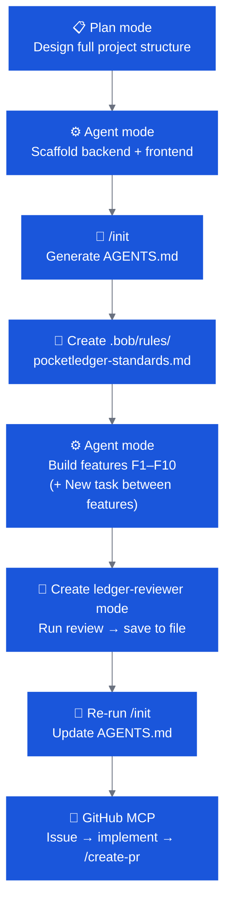

# 🏆 OpenSlava — Final Challenge

**Open build · No time limit · First 3 to submit win a prize**

---

## The Challenge

You have spent the last 90 minutes learning every dimension of IBM Bob — modes, `/init`, rules, custom modes, MCP, GitHub automation, and security auditing. Now put it all together in one coherent product, built entirely with Bob.

**The first three participants to submit a passing pull request win a prize.**

---

## Your Mission: PocketLedger

Build **PocketLedger** — a personal finance tracker with a React frontend, a FastAPI backend, and a full Bob-powered development workflow baked in.

### Application description

PocketLedger helps individuals track income and expenses. Users add transactions, see a live balance, and review a spending breakdown by category. The codebase must be clean, tested, and security-aware from the start — because you are going to use Bob to enforce that, not just hope for it.

### Feature list

| # | Feature | Layer |
|---|---|---|
| F1 | Add a transaction (amount, description, category, date) | Backend + Frontend |
| F2 | List all transactions, newest first | Backend + Frontend |
| F3 | Delete a transaction by ID | Backend + Frontend |
| F4 | Live balance display (sum of all amounts, signed) | Frontend |
| F5 | Spending breakdown by category (aggregated totals) | Backend + Frontend |
| F6 | Simple bar chart for category totals (vanilla JS Canvas or SVG — no charting library) | Frontend |
| F7 | Filter transactions by category via a dropdown | Frontend |
| F8 | Data persisted to a SQLite database (no in-memory store) | Backend |
| F9 | All API endpoints protected by a static bearer token (from environment variable) | Backend |
| F10 | At least 5 unit tests covering the data layer | Backend |

### Technology constraints

- **Backend:** Python 3.11+ · FastAPI · SQLite (via `sqlite3` or `SQLAlchemy`) · `uvicorn`
- **Frontend:** React 18+ · Vite · plain CSS (no component library, no Tailwind)
- **No external charting libraries** (Chart.js, D3, Recharts, etc.) for F6
- **Auth:** static bearer token read from `POCKETLEDGER_TOKEN` env var — no OAuth, no sessions

---

## Bob Requirements

This is not just an application challenge — it is a **Bob workflow** challenge. Your submission must demonstrate that you used Bob correctly and completely. The following Bob artefacts are **required** and will be checked by the judges.

!!! info "Why are Bob artefacts required?"
    The challenge is designed to test whether you can apply the **full Bob development workflow**, not just generate code quickly. Judges are looking for evidence that you:

    - Used `/init` to give Bob persistent project context
    - Created rules to enforce standards automatically (not just as prompts)
    - Built a custom mode with appropriate permission restrictions
    - Drove the full GitHub SDLC loop with MCP

    A working app with no Bob artefacts scores zero. An app that demonstrates every Bob pattern — even if imperfect — scores high.

### B-REQ-1 — `/init` generated `AGENTS.md`

Run `/init` on the completed codebase. The `AGENTS.md` at the repo root must exist and must describe:

- The two-service architecture (backend + frontend)
- The auth model (bearer token from env)
- The database layer
- At least one project-specific constraint Bob inferred or that you added

!!! tip "When to run `/init`"
    Run `/init` **after** the project skeleton is in place — not on an empty folder. Then re-run it after you add a new module (e.g. when you add authentication). Each re-run refreshes Bob's map of the codebase.

    You can also manually add constraints to `AGENTS.md` that Bob couldn't infer from the code: deployment notes, known limitations, team conventions. The judges will reward a well-curated `AGENTS.md`.

### B-REQ-2 — Team rules file

Create `.bob/rules/pocketledger-standards.md` containing at minimum these three rules:

```markdown
All Python functions that handle monetary amounts must use the Decimal type, never float.
This avoids IEEE 754 rounding errors that are unacceptable for financial data.

All React components must have a JSDoc comment describing their props.

After every Agent mode interaction, append a one-line entry to bob-audit/audit.log
in the format: [ISO timestamp] [mode] [brief description of change]
```

Run at least one Agent mode interaction after creating the rules and confirm `bob-audit/audit.log` has a new entry.

!!! info "Rules enforce standards without reminders"
    Once this rules file exists, Bob will:

    - Use `Decimal` automatically in every monetary function it writes
    - Add JSDoc comments to every React component it creates
    - Append to `bob-audit/audit.log` after every Agent interaction

    You don't need to ask. You don't need to remind Bob. The standard is always active. This is the difference between rules and prompts: rules are permanent, prompts are per-conversation.

!!! info "Why `Decimal`, not `float`?"
    IEEE 754 floating-point arithmetic accumulates rounding errors. `0.1 + 0.2` in Python float is `0.30000000000000004` — not `0.3`. For financial data, that is a correctness bug. `Decimal` provides exact decimal arithmetic and is the standard in any Python fintech or accounting codebase. The Expert track uses the same rule.

### B-REQ-3 — Custom `ledger-reviewer` mode

Create `.bob/custom_modes.yaml` with a `ledger-reviewer` mode that:

- Has `read` and `mcp` tool groups only (no `edit`, no `command`)
- Has a `roleDefinition` describing it as a security-focused finance code reviewer
- Has at least 3 `customInstructions` items covering: float precision, hardcoded secrets, and input validation

Use the mode to run at least one review prompt and include the output (copy it into a file `ledger-review/initial-review.md` in the repo).

!!! tip "Switch to your custom mode with a slash command"
    Once `.bob/custom_modes.yaml` is saved, type `/ledger-reviewer` in the chat to switch to it instantly. You don't need to navigate through the settings menu.

!!! info "Why a read-only reviewer mode?"
    `ledger-reviewer` with no `edit` or `command` groups **cannot modify your code**, even if you ask it to. This enforced read-only constraint means you can run compliance reviews without any risk of unintended changes to your working code.

    The output you save to `ledger-review/initial-review.md` becomes your project's first formal security review — committed to version control alongside the code it reviewed.

### B-REQ-4 — GitHub issue → PR loop

1. Push your repo to GitHub (public or private, your choice)
2. Create a GitHub issue titled **"Add CSV export for transactions"** with a description of the feature
3. Use **Agent** mode (with GitHub MCP) to read the issue, implement the endpoint, commit on a feature branch, and open a PR that references the issue number

The PR must exist on GitHub and must reference the issue. The CSV export endpoint does not need to be production-perfect — it just needs to exist and work for the basic case.

!!! tip "Use `/create-pr` for the PR step"
    After Bob has committed and pushed the feature branch, type `/create-pr` in the chat. Bob reads the git diff, identifies the linked issue from your branch name and commit message, generates a PR description, and creates the PR via GitHub MCP — all in one command.

!!! info "Why issue → branch → PR, not just a direct commit?"
    The issue-to-PR loop creates a traceable link: requirement → implementation → review. This is the professional engineering workflow that works at scale.

    When Bob reads the issue and generates a PR description that references `#<issue-number>`, GitHub automatically:
    - Links the PR to the issue
    - Closes the issue when the PR merges

    The audit trail is automatic. This is what "Bob as a team tool" looks like in practice.

---

## Submission

### How to submit

When you are done, **call over a facilitator** — they will check your screen live.

### What the facilitator will check

| Check | Pass criteria |
|---|---|
| All 10 features (F1–F10) present | Verified by running `./start.sh` and testing the UI |
| `AGENTS.md` exists and is non-trivial | File present, >20 lines, describes architecture |
| `.bob/rules/pocketledger-standards.md` exists | File present, contains the 3 required rules |
| `bob-audit/audit.log` has entries | File present, at least 1 entry |
| `.bob/custom_modes.yaml` defines `ledger-reviewer` | Mode present, read-only groups only |
| `ledger-review/initial-review.md` present | File present, non-empty |
| GitHub PR references the issue | PR description contains `#<issue-number>` |
| Tests pass | `pytest` exits 0 in the backend directory |

### Scoring tiebreaker

If multiple submissions arrive at the same time, the tiebreaker is quality of `AGENTS.md` — specifically how well Bob was guided to capture the real architectural decisions of the project.

---

## Recommended workflow

Following the patterns you learned in the tracks will get you to a submission faster than guessing. Here is the recommended sequence:



!!! tip "Start new tasks frequently"
    Each feature (F1 through F10) should ideally be its own Bob task. Clean context per feature means:

    - Bob focuses only on the feature at hand
    - Errors in one feature don't contaminate the next
    - The token budget stays healthy throughout

    If you try to build all 10 features in a single conversation, the context window will fill and quality will degrade by F7.

---

## Hints & Guidance

These hints are here if you get stuck. Try without them first.

??? tip "Hint 1 — Recommended start sequence"
    1. Create an empty folder `pocketledger/`
    2. Open it in **IBM Bob**, switch to **Plan** mode, paste the feature list and ask Bob to design the full project structure
    3. Start a **+ New task**, switch to **Agent** mode, scaffold both services
    4. Run `/init` once the skeleton is in place
    5. Create your rules file before writing any business logic
    6. Build features F1–F10 in Agent mode, one or two features per task

??? tip "Hint 2 — Bearer token pattern (FastAPI)"
    ```python
    from fastapi import Header, HTTPException
    import os

    def verify_token(authorization: str = Header(...)):
        expected = f"Bearer {os.environ['POCKETLEDGER_TOKEN']}"
        if authorization != expected:
            raise HTTPException(status_code=401, detail="Unauthorized")
    ```
    Add `Depends(verify_token)` to every route that should be protected.

    The token is read from the environment — never hardcoded. If Bob ever hardcodes a token value, ask it to move the value to `.env` and load it with `os.environ`.

??? tip "Hint 3 — Vanilla JS bar chart approach"
    Ask Bob in **Plan** mode first:
    ```
    Design a vanilla JS bar chart using the Canvas API that takes an array of
    { category: string, total: number } objects and renders horizontal bars.
    No external library.
    ```
    Then start a **+ New task** and switch to **Agent** mode to implement.

    The Plan → new task → Agent pattern is particularly important here because the chart logic is complex enough to benefit from a design pass.

??? tip "Hint 4 — start.sh template"
    Your repo should include a `start.sh` at the root that starts both services so judges can run it easily:
    ```bash
    #!/usr/bin/env bash
    set -e
    export POCKETLEDGER_TOKEN="${POCKETLEDGER_TOKEN:-dev-token-123}"
    cd backend && pip install -r requirements.txt -q && uvicorn main:app --reload --port 8000 &
    cd ../frontend && npm install -q && npm run dev &
    wait
    ```

??? tip "Hint 5 — GitHub MCP PR prompt"
    ```
    Read GitHub issue #<number> from this repo.
    Create a branch called feature/csv-export.
    Implement a GET /transactions/export endpoint in main.py that returns
    a CSV with columns: id, date, description, category, amount.
    Use Python's built-in csv module.
    Commit the change and open a pull request referencing the issue.
    ```
    Then in the same chat type `/create-pr` to trigger the PR workflow.

??? tip "Hint 6 — Context hygiene during the build"
    If Bob starts giving inconsistent responses or producing code that doesn't match your existing files:

    1. Start a **+ New task**
    2. Reference your key files directly: `@/backend/main.py @/frontend/src/App.tsx`
    3. Remind Bob of the AGENTS.md conventions: `"Follow the AGENTS.md conventions in this project"`

    Clean context is the single most effective fix for drift. Don't try to correct Bob in a long conversation — reset and start fresh.

---

## Prize

The **first 3 participants** to submit a passing pull request receive an IBM Bob prize. 🏆

Good luck — and enjoy building with Bob.
