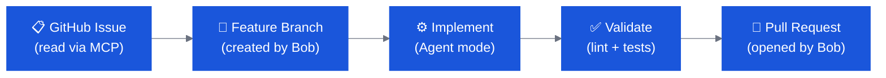
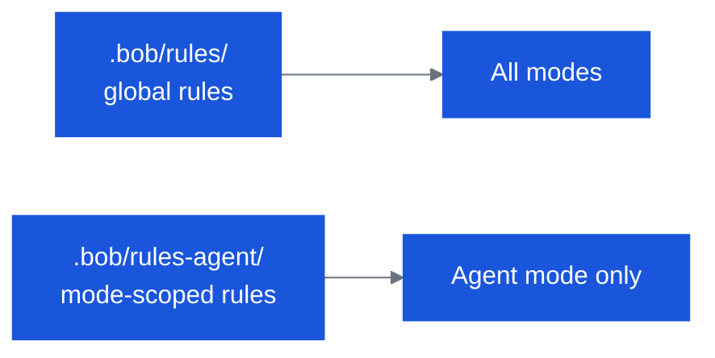

# OpenSlava — Intermediate Track

Two labs · ~70 minutes total · Assumes basic Bob familiarity

---

## Track Overview

| # | Lab | Time | Goal |
|---|---|---|---|
| I1 | **GitHub SDLC with Bob** | 40 min | Drive a full issue → branch → implement → PR loop with GitHub MCP |
| I2 | **Author, Modify & Commit Rules** | 30 min | Build version-controlled team standards that Bob applies automatically |

---

## Prerequisites

- [ ] **IBM Bob IDE** installed and signed in — download from [bob.ibm.com/download](https://bob.ibm.com/download) (standalone app, not a VS Code extension), or **Bob Shell** if you prefer a terminal (`curl -fsSL https://bob.ibm.com/download/bobshell.sh | bash`)
- [ ] Git configured (`git config --global user.name` and `user.email`)
- [ ] GitHub account with a personal access token (`repo` scope)
- [ ] GitHub MCP installed in Bob (see Lab I1 Step 1)

---

## Lab I1 — GitHub SDLC with Bob

**40 minutes**

### What you will learn

Bob can drive an entire software development lifecycle — reading a GitHub issue, creating a branch, implementing the change, running validation, and opening a PR — without you leaving your editor. This lab shows you how, and more importantly, **why** this is valuable.



### Why MCP matters for SDLC

MCP (Model Context Protocol) servers extend Bob with **real-world integrations**. Without MCP, Bob can only interact with your local filesystem. With GitHub MCP, Bob can:

- Read and create issues
- Create branches
- Commit and push files
- Open pull requests — with a description that references the issue number

This turns Bob from a local coding assistant into a **connected engineering agent** that works within your team's actual workflow. Issues stay linked to implementations, PRs reference requirements, and the audit trail is automatic.

### Step 1 — Install GitHub MCP

**Option A — from the chat (recommended):** type `/configure-mcp` in Bob's chat, then search for **GitHub**, click **Install**, and set `GITHUB_TOKEN` to your personal access token (`repo` scope).

**Option B — from the sidebar:** Bob sidebar → **Marketplace** icon → search **GitHub** → **Install** → Settings → MCP → GitHub → set `GITHUB_TOKEN`.

Either way, verify there is no red error badge on the MCP server entry and that Bob shows GitHub tools in the sidebar.

!!! tip "Use `/configure-mcp` — it's the fastest path"
    `/configure-mcp` opens the MCP configuration panel directly from chat without leaving your current conversation. Use it any time you need to add or update an integration mid-task.

!!! tip "Create a token"
    GitHub → Settings → Developer settings → Personal access tokens → Tokens (classic) → New token → tick **repo** → Generate.

!!! info "Global vs project scope"
    MCP configuration can live at two levels:
    - **Global** (`~/.bob/mcp_settings.json`) — available in all workspaces
    - **Project** (`.bob/mcp.json`) — scoped to this repo, can be committed for team use

    For team projects, committing `.bob/mcp.json` means everyone who clones the repo gets the same MCP configuration automatically.

### Step 2 — Open the lab repo in IBM Bob

```bash
cd intermediate/labs/github-sdlc
```

Open this folder in **IBM Bob**. It contains a React finance app skeleton and supporting docs.

### Step 3 — Plan and build the finance dashboard

Switch to **Agent** mode. Start by having Bob understand the project and plan the build:

```
Review this repository and propose a build plan for a small React finance dashboard application.
The app should use Yahoo Finance data for:
- Euro Stoxx 50 (`^STOXX50E`), DAX (`^GDAXI`), Nikkei 225 (`^N225`),
  Dow Jones Industrial Average (`^DJI`), and MSCI World (`URTH`).
The dashboard should provide views for current day, last 7 days, and last quarter.
Explain the recommended project structure, data-fetching approach, UI sections, and testing strategy.
```

Once Bob has responded, scaffold the application:

```
Create a React application structure for this repository inside a directory named "finance-app".
Include a dashboard page, reusable chart card components, a finance data service layer,
and a clean folder layout suitable for future enhancements.
```

**Observe:** Bob creates the `finance-app` directory with the full project structure.

### Step 4 — Integrate Yahoo Finance data

!!! warning "Yahoo Finance and CORS"
    Yahoo Finance does not allow direct browser requests — the browser will block them with a CORS error. **The data layer must run server-side** (a small Node/Express or Python proxy that the React frontend calls). Ask Bob to implement this pattern; the lab prompt below instructs it to do so.

Start a **+ New task** in Bob and send:

```
Implement a finance data layer for the following stock indices using Yahoo Finance data:
Euro Stoxx 50 (`^STOXX50E`), DAX (`^GDAXI`), Nikkei 225 (`^N225`),
Dow Jones Industrial Average (`^DJI`), and MSCI World (`URTH`).

Fetch the data server-side via a lightweight proxy (e.g. a small Express or FastAPI server)
to avoid CORS restrictions — the React frontend must call this proxy, not Yahoo Finance directly.
Normalize the returned data so the UI can display quote summaries,
short-term history, and quarterly trend views.
Keep the code easy to extend if more indices need to be added later.
```

In the same chat, build the dashboard views:

```
Build 2 to 3 dashboard views for the finance application:
- current day market summary
- last 7 days trend comparison
- last quarter comparison view

Include all five stock indices. Use charts and summary cards. Keep the UI simple and demo-friendly.
```

Run the app locally to verify:

```bash
cd finance-app
npm install
npm run dev
```

!!! info "Why start a new task for each phase?"
    Bob's context window is 270,000 tokens — large but finite. Each file read, command output, and response consumes budget. Starting a new task with **+ New task** between phases keeps each conversation focused.

    Think of it as a clean desk rule: clear yesterday's notes before starting today's work. The planning output is saved to disk (as plan files), not just in the chat, so the implementation task can reference files rather than long conversation history.

### Step 5 — Add validation and tests

Start a **+ New task** in Bob and send:

```
Add appropriate validation for the finance dashboard project.
Include unit tests for the data formatting and normalization utilities,
and integration tests for at least one dashboard view rendered with mocked API data.
Use MSW to mock the finance API responses in tests.
Provide a single command that runs lint, type-check, tests, and build together,
and summarize what a successful run looks like.
```

Run the validation suite:

```bash
cd finance-app
npm run validate
```

A successful run completes without errors — lint, type-check, tests, and build all pass.

!!! tip "Let Bob write the test scaffolding"
    Asking Bob to provide "a single command that runs lint, type-check, tests, and build together" is a smart delegation. Bob knows the standard npm script conventions and wires up the `validate` script in `package.json`. You get a repeatable quality gate without writing a shell wrapper yourself.

### Step 6 — Push to GitHub

1. Go to [https://github.com/new](https://github.com/new) and create a new repo named `finance-app` (no README, no .gitignore)
2. Copy the GitHub Actions CI config into your project:

```bash
# from the github-sdlc lab root
cp -r .github finance-app/.github
```

3. Initialize git and push:

```bash
cd finance-app
git init
git add .
git commit -m "Initial commit: finance dashboard"
git remote add origin https://github.com/YOUR_USERNAME/finance-app.git
git branch -M main
git push -u origin main
```

4. On GitHub, go to **Settings → General** and confirm **Issues** is enabled
5. Create a feature branch:

```bash
git checkout -b feature/user-selected-chart
git push -u origin feature/user-selected-chart
```

!!! tip "Small, frequent commits are the professional pattern"
    Notice that the initial commit includes _everything_ — but from this point on, each feature should get its own commit. Bob can help: at any time in Agent mode, ask `"Commit the changes made so far with a descriptive message."` Bob reads your git diff and writes a meaningful commit message automatically.

### Step 7 — Create a GitHub issue

On GitHub, open **Issues → New issue**:

- **Title:** `Add a graph for a user-selected index`
- **Body:** `Users should be able to type any stock ticker symbol and see a new chart for that symbol alongside the existing dashboards. Include loading and error states. Existing dashboard views must not be affected.`

Note the issue number (e.g. `#1`).

!!! info "Issues as the contract between requester and implementer"
    Writing a clear issue before implementing is a best practice that makes the automated PR loop much more powerful. When Bob reads the issue via MCP, it has a precise specification — not just a vague description you typed in a chat. The issue becomes the source of truth: referenced in the branch name, referenced in the PR description, closed automatically when the PR merges.

### Step 8 — Issue-to-PR loop

Open a **+ New task** in Bob (**Agent** mode) and send — replace `#1` with your actual issue number:

```
Fetch and analyze GitHub issue #1 from this repository.
Explain the requested feature, identify which files need to change,
and propose an implementation plan.
```

In the same chat, implement:

```
Implement the feature described in the GitHub issue.
Add a user input for a stock ticker symbol that fetches and displays a new chart
for that symbol alongside the existing dashboards.
Reuse the existing data service layer, keep the UX simple,
and preserve all existing dashboard views.
```

Validate:

```
Run the full validation suite. Summarize what passed, what failed,
and whether the branch is ready to push to GitHub.
```

Start a **+ New task** in Bob, then commit and push:

```
Review the changes made to implement the user-selected index chart feature in finance-app/.
Summarize what was added, fix any obvious problems, commit with a meaningful message,
and push to the feature/user-selected-chart branch. Do not yet create a pull request.
```

!!! tip "Why a new task for 'review and commit'?"
    The implementation task may have left stale reasoning in its context — half-formed plans, earlier error messages, abandoned file reads. Starting a fresh task to review and commit means Bob is reading the **final state of the files**, not the history of how they were produced. Clean context = accurate review.

### Step 9 — Create the pull request

In the same chat, type this command directly:

```
/create-pr
```

Bob will display a workflow dialog. Click **"Start workflow"**, leave the pre-filled **Repository** and **Base Branch** values as-is, then click **"Generate PR Description"**.

**Observe:** Bob reads the git diff, detects the linked issue, fills in the PR template, and creates the pull request automatically.

!!! info "What `/create-pr` does"
    `/create-pr` is a **built-in Bob slash command** that triggers a structured PR workflow. Bob:

    1. Reads the current git diff
    2. Identifies the linked issue from your branch name and commit messages
    3. Generates a PR title and description following your repo's PR template (if one exists)
    4. Creates the PR via GitHub MCP

    You review the generated description before it is posted. You are always in the loop.

!!! tip "Check the PR on GitHub"
    Visit the **Pull requests** tab on your repo to confirm the PR exists and references the issue number.

### Reflection

Switch to **Ask** mode:

```
In the SDLC loop we just ran, which steps required a human decision
and which were fully automated by Bob?
What are the risks of fully automating the PR step?
```

!!! info "Humans stay in the loop by design"
    Bob's automation is always **propose, then approve**. You review the implementation plan. You approve each file write. You review the PR description before it posts. The automation handles the mechanical repetition — finding files, writing boilerplate, remembering to reference the issue number — while you focus on the decisions that actually require judgement.

---

## Lab I2 — Author, Modify & Commit Rules

**30 minutes** · Requires Lab I1 complete (git configured)

### What you will learn

Rules are plain Markdown files that Bob reads before every conversation. They are version-controlled alongside your code and act as always-on team standards — no prompting required.



### Why rules change the development pattern

Without rules, every Bob conversation starts blank. You repeat the same "our project uses X, always do Y" instructions in every prompt. With rules, those standards are injected automatically — enforced at the start of every conversation, in every mode, for every team member.

Rules are a force multiplier:

- **Consistency without supervision** — Bob follows the standard even when you forget to mention it
- **Automatic onboarding** — new team members get the rules the moment they clone the repo
- **Code-review for standards** — rule changes go through your normal PR process, so the team agrees on them before they take effect

### Step 1 — Create global rules

Open `galaxium-travels/` in **IBM Bob**. If the directory is empty, initialize the submodule first:

```bash
git submodule update --init galaxium-travels
```

In **Agent** mode:

```bash
mkdir -p .bob/rules
```

Create `.bob/rules/01-standards.md` with this content:

```markdown
Always include JSDoc comments for every public function.

Be very concise in responses.

After every Bob interaction, write a summary to the folder `internal-monologue/`.
Name each file with a timestamp prefix followed by a concise description.
Example: 2026-01-15_update-readme.md
```

!!! info "Why put rules in `.bob/rules/`?"
    Files in `.bob/rules/` are **global to all modes** — they apply whether Bob is in Ask, Plan, or Agent mode. This is the right place for standards that should always be active regardless of what Bob is doing.

    The numeric prefix (`01-`) controls load order. If you have multiple rules files and some should take precedence, use `01-`, `02-`, etc.

### Step 2 — Test the rules

In **Agent** mode, ask Bob to add a utility function:

```
Add a utility function called formatPrice to
booking_system_frontend/src/services/api.ts
that takes a number and returns a string formatted as "€1,234.56".
```

**Observe:**

- Bob adds the function with a JSDoc comment automatically — because the rule says so
- A new file appears in `internal-monologue/` describing what was changed

!!! tip "This is the value of rules over prompts"
    You didn't ask for a JSDoc comment. You didn't ask for a summary. Bob did both because the rules told it to. As a team practice, this means code quality standards are enforced without relying on every developer to remember to ask for them.

### Step 3 — Modify a rule

Edit `.bob/rules/01-standards.md` — change `internal-monologue/` to `bob-log/`:

```markdown
After every Bob interaction, write a summary to the folder `bob-log/`.
Name each file with a timestamp prefix followed by a concise description.
Example: 2026-01-15_update-readme.md
```

Ask Bob to make another small change:

```
Add a formatDate utility function to the same api.ts file
that formats an ISO date string as "DD MMM YYYY".
```

**Observe:** Bob writes to `bob-log/` now, not `internal-monologue/`.

!!! info "Rules are live — no restart required"
    Bob reads rules files at the start of each conversation, not at IDE startup. Change a rule, start a new task, and the new rule takes effect immediately. This makes it easy to experiment with different standards before committing them.

### Step 4 — Add a mode-scoped rule

Create `.bob/rules-agent/02-agent-commits.md`:

```markdown
In Agent mode, after every file change create a git commit
with a descriptive message summarising what was changed and why.
```

Make a small code change in Agent mode (e.g. rename a variable). **Observe:** Bob commits automatically with a useful message.

!!! info "Mode-scoped rules"
    Files in `.bob/rules-agent/` are only injected when Bob is in Agent mode.
    Files in `.bob/rules/` are injected in every mode.
    Mode slug for built-in modes: `agent`, `plan`, `ask`.

    **This is powerful for compliance.** An auto-commit rule in Agent mode means every file Bob touches is committed with a traceable message — a complete audit trail of what Bob did and why, baked into your git history.

### Step 5 — Commit the rules

```bash
git add .bob/ && git commit -m "Add team Bob rules for Galaxium Travels"
```

**Discussion:** Why do rules belong in version control alongside the code they govern?

- New team members get the standards automatically on first `git clone`
- Rule changes are reviewed through the normal PR process
- Rules are scoped to the project, not the developer's global Bob config
- The full history of what standards were active at any commit is preserved

!!! info "Rules vs. AGENTS.md — what is the difference?"
    | | `AGENTS.md` | `.bob/rules/*.md` |
    |---|---|---|
    | **Generated by** | `/init` (automated) | You (manual) |
    | **Purpose** | Describe the project structure | Define behaviour standards |
    | **Edited by** | Bob + you | You (or Bob, on instruction) |
    | **Example content** | "This project has a FastAPI backend and a React frontend" | "Always use Decimal for monetary values" |

    Use both together: `AGENTS.md` tells Bob **what the project is**, rules tell Bob **how to behave in it**.

### Step 6 — Verify the rules persist

Close and reopen **IBM Bob**, then ask Bob something simple in Agent mode. Check that `bob-log/` gets a new entry — confirming the rules survive a session restart.

!!! tip "Rules + AGENTS.md + mode scoping = team Bob configuration"
    The combination of all three forms a complete Bob configuration for a project:

    1. **`AGENTS.md`** — project context (what is this codebase?)
    2. **`.bob/rules/`** — global standards (always apply)
    3. **`.bob/rules-agent/`** — agent-specific behaviour (auto-commit, auto-audit)
    4. **`.bob/custom_modes.yaml`** — custom personas (covered in Expert track)

    All of it is version-controlled. All of it propagates automatically on `git clone`. This is what "Bob as a team tool" looks like.

---

## What's next?

| If you want to go deeper… | Try |
|---|---|
| Custom modes, MCP, fintech audit, GitHub MCP E2E | [Expert Track](openslava-expert.md) |
